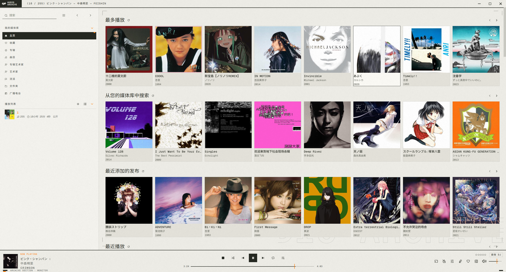
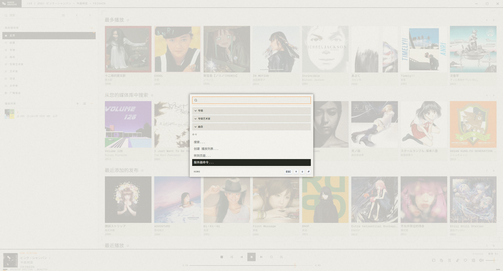
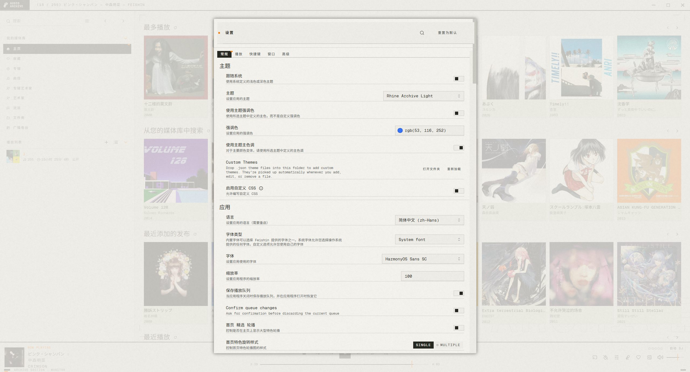
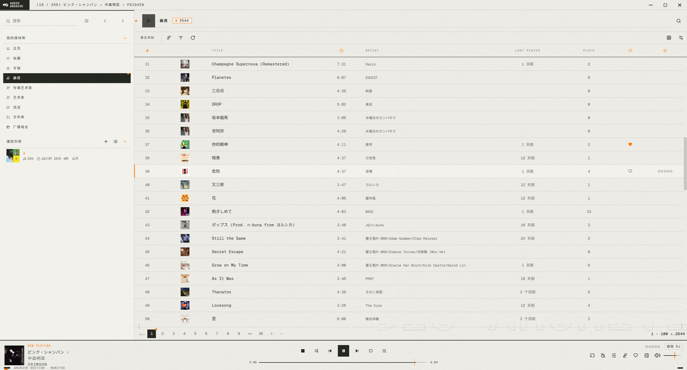
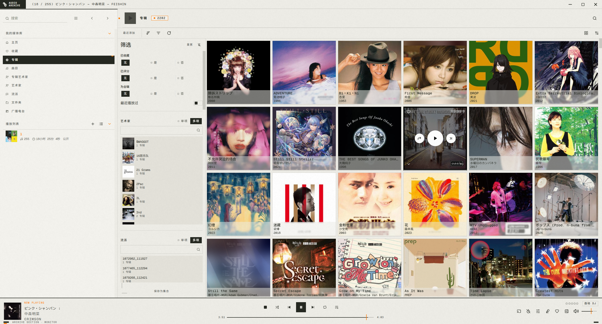
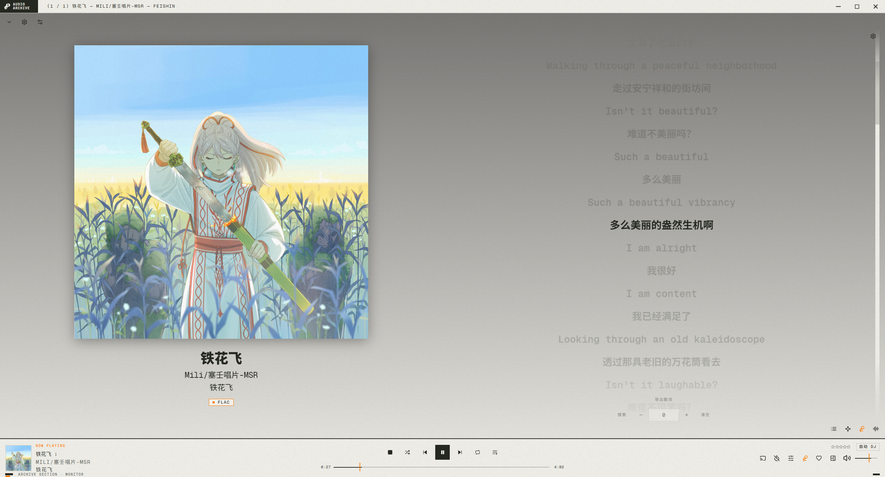

# RHINe for Feishin

Feishin 的原生主题包。五套配色,每套含浅色与深色两种,共十个主题。

## 配色

| 配色 | 页面底色 | 强调色 |
| --- | --- | --- |
| `ARCHIVE` | 暖白纸 / 近黑 | `#ff7a01` 橙 |
| `HAZARD` | 骨白 / 近黑 | `#ffcf1a` 黄 |
| `FLARE` | 橙色场 / 余烬 | `#ff6b1a` 橙 |
| `FIELD` | 淡绿 / 近黑 | `#4fdc76` 绿 |
| `COLD FRONT` | 淡蓝 / 近黑 | `#3d8bff` 蓝 |

## 截图

### 主页



### 搜索



### 设置页



### 曲目列表页



### 专辑列表页



### 播放页



## 安装

### 1. 字体

主题的字体栈引用 Geist Mono,它是 SIL OFL 1.1 授权(许可文本见 `themes/fonts/OFL.txt`)。把五个静态字重
**按用户**安装,不需要管理员权限。在仓库根目录用 PowerShell 执行:

```powershell
$dst = "$env:LOCALAPPDATA\Microsoft\Windows\Fonts"
$key = "HKCU:\Software\Microsoft\Windows NT\CurrentVersion\Fonts"
New-Item -ItemType Directory -Force -Path $dst | Out-Null
foreach ($f in Get-ChildItem .\themes\fonts\GeistMono-*.ttf) {
    $target = Join-Path $dst $f.Name
    Copy-Item $f.FullName $target -Force
    $family = switch ($f.BaseName) {
        'GeistMono-Light'    { 'Geist Mono Light' }
        'GeistMono-Medium'   { 'Geist Mono Medium' }
        'GeistMono-SemiBold' { 'Geist Mono SemiBold' }
        'GeistMono-Bold'     { 'Geist Mono Bold' }
        default              { 'Geist Mono' }
    }
    New-ItemProperty -Path $key -Name "$family (TrueType)" -Value $target -PropertyType String -Force | Out-Null
}
```

不装字体也能用:拉丁字符会落到系统等宽字体,中文日文由 Feishin 自带的开源字体承担,只是不是你设计的原本字型。

### 2. 主题

把 `themes/` 里的两个 `.css` 和十个 `.json` 复制到 Feishin 的自定义主题目录:

```
%APPDATA%\feishin\Themes\
```

Feishin 会自动读取这个目录;"自定义主题"面板里有"打开文件夹"按钮。

### 3. 选择

在 Feishin 中打开 `设置 → 通用 → 主题`,选例如 `ARCHIVE Dark`。

同时请把 `设置 → 高级 → 自定义 CSS` 的开关**关掉**:这些是主题,不是自定义 CSS,两者同时开着会互相干扰。

## 常见问题

**中文和日文能正常显示吗?**
能。中日韩文字依次回退到 `Noto Sans SC`、`Source Han Sans SC`、`Noto Sans JP`,其中最后一个是 Feishin 自带的,
所以任何机器上都不需要额外安装。

**想让界面跟着系统在明暗之间切换?**
打开 `跟随系统主题`,把 `深色` 设成某个深色主题、`浅色` 设成某个浅色主题即可。

**怎么彻底移除?**
删除 `Themes` 目录里 `rhine-` 开头的文件;如果要一并移除字体,删掉那五个 `.ttf` 与注册表里对应的五条记录。

## 目录结构

```
themes/                        直接复制进 %APPDATA%\feishin\Themes
  rhine-base.css               样式表
  rhine-extras.css             关键帧,主题通道专属
  rhine-<配色>-<明暗>.json      十个主题:colors、app token、mantineOverride
  fonts/                       Geist Mono 五个静态字重 + OFL.txt
screenshots/                   界面截图
```

## 许可

- Geist Mono: SIL Open Font License 1.1,见 `themes/fonts/OFL.txt`。